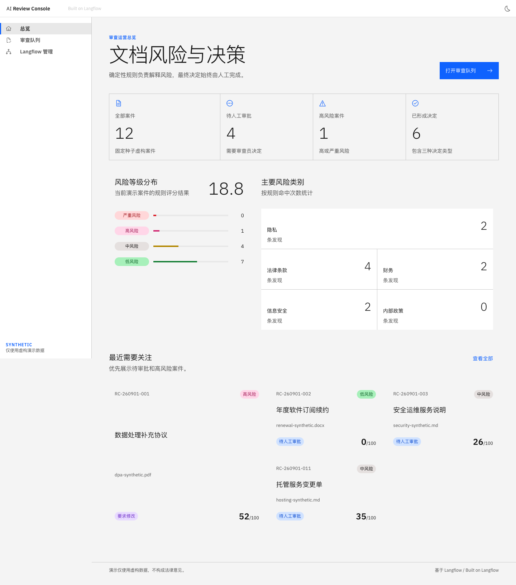
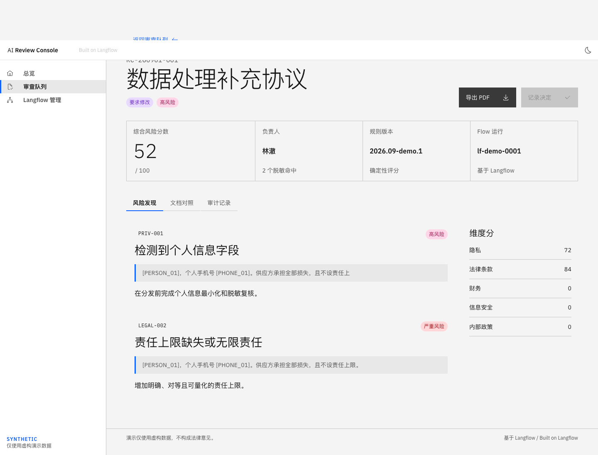

# AI Review Console

[GitHub 仓库](https://github.com/qife422/ai-review-console) · [更新记录](CHANGELOG.md) · [恢复与更新](docs/RESTORE.md)

AI Review Console 是一个基于 Langflow 的 AI 文档审查与决策中心参考实现。它使用完全虚构的数据演示文档解析、确定性脱敏、可解释风险评分、人工审批与 JSON/HTML/PDF 报告导出。

Langflow-powered document review console with deterministic redaction, explainable rule scoring, human decisions, and version-bound reports. This is a synthetic-data reference implementation, not a production service or an LLM-powered reviewer.

> **SYNTHETIC DEMO DATA ONLY / 演示仅使用虚构数据**  
> 本项目不包含任何公司机密、客户数据、真实合同、生产凭据或真实决策记录。

## 项目定位与当前状态

当前仓库保存 **v0.2 开发快照**：网页上传新虚构文件，数据库任务驱动真实 Langflow Intake，API 校验并持久化结果；版本绑定的人工决定触发 Decision Flow，登记并下载 JSON/HTML/中文 PDF。12 个种子案件仅用于演示，不冒充上传或真实运行记录。评分仍是确定性规则，不调用大模型，不自动批准。

适合学习工作流编排、展示文档审查交互，以及继续开发一个可追溯的审查控制台。尚未完成生产验收，不能处理真实客户文档或直接对公网提供服务。

此前本地已观察到四格式 Intake、三种人工决定与报告下载闭环，以及桌面/移动端双主题浏览器验收。最后一轮边界修复后的整栈回归、容器故障恢复、恢复目标启动、线上漏洞扫描和远端 CI 仍须分别核验；不能把源码存在、历史运行记录或本次 GitHub 备份当成这些项目已经通过。

固定实施 Contract 为 [Spec计划书](docs/UPGRADE_SPEC.md) `ARC-UPGRADE@0.1.0`。实际验收、内容指纹和剩余边界见 [当前状态](docs/CURRENT_STATE.md)及[Spec索引](docs/SPEC_INDEX.md)。本地技术验证与负责人最终接受分开；没有生产或收费模型授权。

上述状态文档保留了实施阶段的交接记录，部分描述早于当前代码快照；本次备份及待验证范围另见 [更新记录](CHANGELOG.md)。固定 Spec 和历史证据不因上传而改写。

## 基于 Langflow

本项目使用 [Langflow](https://github.com/langflow-ai/langflow) `1.11.6` 作为可视化工作流编排和运行时，并通过五个可信自定义组件实现审查流程。Langflow 是独立的 MIT 许可上游项目；本项目与 Langflow 官方不存在隶属或背书关系。

日常审查使用独立的 Web 仪表盘。Langflow UI 只用于受控管理员查看 Flow，不作为面向终端用户的安全边界。

## 内容与功能

| 模块 | 主要功能 |
| --- | --- |
| 文件上传与解析 | PDF、DOCX、TXT、Markdown；虚构标识和类型/大小校验，源文件字节 SHA-256，重复请求去重 |
| 脱敏对照 | 邮箱、电话、虚构证件号、账号、地址和人员字段的确定性占位符；原文与脱敏版本对照 |
| 风险评估 | 0–100 分的规则评分，隐私/法律/财务/安全/政策维度，发现、证据和页/段落/表格定位；尚未评分时显示未知而非假零分 |
| 人工决定 | 批准、驳回、要求修改；身份/理由校验，绑定文档版本与评估，并发提交冲突保护；规则结果不会自动决定 |
| 后台工作流 | 两条真实 Langflow Flow、持久化任务、租约领取、执行 token、错误与重试状态；API 是业务记录的唯一写入口 |
| 报告与审计 | 保存决定快照，生成 JSON/HTML/中文 PDF，登记并核验下载字节哈希；部分失败保留决定和已就绪格式；记录业务审计事件 |
| 审查界面 | React + Carbon 仪表盘、队列、详情、对照、上传与报告面板；浅/深色主题、响应式和键盘操作 |
| 开发与演示 | 12 个虚构种子案件、四格式样本、示例报告、历史截图、Python/前端测试、浏览器 CLI 验证、Compose 与 GitHub Actions 配置 |

正常关键路径：上传虚构文档 → Intake 解析/脱敏/评分 → 待人工审批 → 记录决定 → Decision Flow → 核验并下载报告。上传接受不等于审查成功，人工决定也不等于报告已经生成。

## 界面预览

以下为仓库保留的历史虚构演示截图，便于展示产品定位，不代表当前所有 v0.2 功能已验收。





移动端队列预览见 [queue-mobile.png](demo/screenshots/queue-mobile.png)，演示话术见 [六分钟演示](docs/DEMO_SCRIPT.md)。

## 架构

```text
Browser -> Review Web -> Review API -> Review PostgreSQL (cases/versions/jobs)
                            ^                      |
                            |                 leased Worker
                            |                      |
                            +--- verified result --+--> Langflow 1.11.6
                                                         trusted components
```

详细决策见 [技术可行性与许可证检查](docs/FEASIBILITY_AND_LICENSE.md)和[开发方案](docs/DEVELOPMENT_PLAN.md)。

主要技术栈：Python 3.12 / FastAPI / SQLAlchemy / PostgreSQL，React / TypeScript / Vite / Carbon，Langflow 1.11.6，ReportLab / pypdf / python-docx，Docker Compose / Nginx。详细运行边界见 [架构](docs/ARCHITECTURE.md)。

## 仓库结构

```text
api/app/                   API、模型、迁移、任务与业务事务
review_core/               解析、脱敏、规则、报告及授权字体
custom_components/         五个可信 Langflow 组件
flows/                     两条 Flow 的可再生定义
frontend/                  审查控制台与前端测试
docker/                    Dockerfile、反向代理和数据库初始化
tests/ + scripts/          回归测试、Flow 发布和受控验证脚本
fixtures/ + examples/      虚构输入与示例报告
demo/                      展示截图和素材
docs/ + compliance/        Contract、历史记录、许可证与扫描候选
```

## 本地开发

要求：Python 3.12、Node.js 22、Docker 28 或兼容版本。

### API

```bash
python3.12 -m venv .venv
.venv/bin/pip install -r requirements.lock
.venv/bin/pip install -e '.[dev]'
.venv/bin/python -m api.app.migrations
.venv/bin/uvicorn api.app.main:app --reload --port 8000
```

API 文档：<http://localhost:8000/docs>

默认 SQLite 文件是新的 `review_console_upgrade.sqlite3`。API/Worker不会自动建表或迁移。原 `review_console.sqlite3` 不作为启动目标；`--allow-existing` 只能用于已获授权的隔离恢复副本。独立 API 仅可查看种子数据；完整上传链路还需要真实 Langflow、已发布的 Flow manifest、共享存储及 Worker，建议使用下面的 Compose。

### Web

```bash
cd frontend
npm ci
npm run dev
```

Web：<http://localhost:5173>

### 测试

```bash
make test
make lint
make web-test
npm --prefix frontend run lint
```

GitHub Actions 配置包含单元检查及真实工作流/浏览器集成作业。它们需要分别成功运行才能视为 CI 通过；首次推送可能自动触发现有工作流。本地数据库并发测试需要单独配置隔离的 `ARC_TEST_POSTGRES_URL`，未配置时会跳过。故障和恢复脚本会操作明确的隔离测试目标，不是普通安装或恢复步骤，不应直接对已有数据运行。

### Docker Compose

以下命令固定独立升级项目，避免复用历史 `ai-review-console` 卷。示例密码和 service token 只用于本机虚构演示；不要用于真实数据或公网。可按 `.env.example` 配置同一套本地凭据。

```bash
npm --prefix frontend ci
npm --prefix frontend run build
COMPOSE_BAKE=false docker compose -p ai-review-console-upgrade build
docker compose -p ai-review-console-upgrade up -d postgres langflow
docker compose -p ai-review-console-upgrade run --no-deps storage-init
docker compose -p ai-review-console-upgrade run migrate
docker compose -p ai-review-console-upgrade run flow-init
docker compose -p ai-review-console-upgrade up -d --no-deps api worker web
```

默认入口：<http://localhost:8080>。Langflow UI 仅绑定本机回环地址：<http://localhost:7860>。
不要把 Langflow 的 `7860` 端口改为公网监听。

Compose 使用刚从锁文件构建的 `frontend/dist`（忽略的可再生产物，不是正式证据），没有运行时源码 bind mount。Langflow 冷启动首次加载组件可能数分钟；`flow-init` 等健康检查再发布。`storage-init` 只设置这三个明确卷根目录权限，不递归更改文件；不得用这些命令指向旧项目来绕过迁移保护。

启动后验证5个组件、真实动态上传/入库、三种决定和九次报告字节哈希下载（在所选隔离库创建新虚构案件）：

```bash
.venv/bin/python scripts/validate_langflow.py --api-url http://localhost:8080
```

## Langflow 自定义组件

组件位于 `custom_components/review_center/`：

- `SyntheticDocumentParser`
- `DeterministicPIIRedactor`
- `ExplainableRiskScorer`
- `ApprovalTaskGateway`
- `DecisionReportExporter`

生产配置关闭 UI 中任意自定义代码编辑，但保留通过 `LANGFLOW_COMPONENTS_PATH` 加载的仓库可信组件。Flow 文件位于 `flows/`，不得包含任何 API Key。

历史 Python/Node/API/Web SBOM 位于 [`compliance/sbom/`](compliance/sbom/)，仅对旧输入有效，不代表当前发布扫描。升级的离线库存/许可证候选及未执行的在线审计边界见 [`compliance/upgrade/README.md`](compliance/upgrade/README.md)；这些候选尚未封存，也不一定绑定当前最后一次修复后的镜像。

## 演示数据

脚本可生成固定种子演示文档，但现有 `fixtures/` 是受保护固定输入，本轮不重新生成或覆盖；要生成候选样本，请先为其指定独立输出和授权范围：

```bash
.venv/bin/python scripts/generate_fixtures.py
```

所有示例文件包含 `SYNTHETIC DEMO DOCUMENT` 标识，域名只使用 `example.com` / `.org` / `.net` 保留域。项目输出不构成法律意见或自动决策。

六分钟演示话术、桌面端/移动端截图与示例报告见 [`demo/`](demo/) 和 [`docs/DEMO_SCRIPT.md`](docs/DEMO_SCRIPT.md)。

## 安全限制

- Langflow 能执行 Python，自定义组件只可由可信维护者发布；
- 浏览器永远不接收 Langflow 管理 API Key；
- 演示鉴权头 `X-Reviewer` 不是生产身份认证；
- 公网、多租户、企业 SSO、细粒度 RBAC 和恶意文件沙箱不在本演示范围；
- 正式部署前必须完成身份系统、基础设施隔离、恶意文件扫描、SBOM、许可证和漏洞复核。

## 备份、恢复与后续更新

GitHub 保存已提交并推送的源码、文档、锁文件、演示素材和提交历史。它**不自动保存未提交改动，也不备份运行数据库、Docker 卷、用户上传文件、运行生成的报告或 `.env` 密钥**。恢复源码后可重新安装依赖并启动全新的虚构演示；要恢复某次运行的案件与报告，还需要独立、受控的数据库与文件备份。

新电脑恢复、日常提交/推送和版本找回方法见 [恢复与更新指南](docs/RESTORE.md)。项目更新记录见 [CHANGELOG](CHANGELOG.md)；Git 提交历史保存更细的代码变更。仓库现已公开，可直接分享本页和历史虚构截图，也可匿名克隆源码。公开源码不等于生产部署或技术验收完成。

## 许可证

本项目自研代码采用 Apache License 2.0。Langflow 采用 MIT License，详见 [第三方通知](THIRD_PARTY_NOTICES.md)及 `licenses/`。
