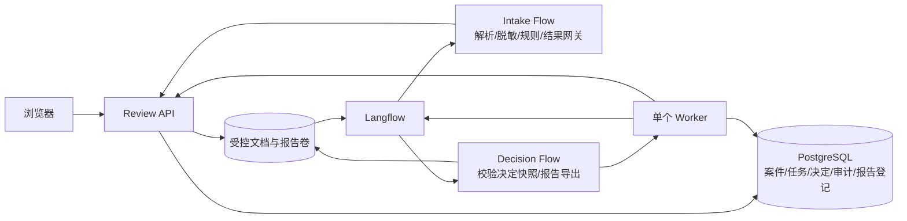

# AI Review Console 完善及后续升级 Spec 计划书

本计划以现有代码为基线，目标是把可演示的参考实现升级为能处理新增虚构文档、真实执行 Langflow、保存审查结果并完成审批与报告的本地小型应用。先完成确定性链路，再引入可选的大模型建议，最后按实际需要推进生产化。

本文是候选 Contract `ARC-UPGRADE@0.1.0`，不是已实施成果。当前请求授权编写计划书；本候选尚未获 Contract 确认，也未获得新一轮功能实施、数据库迁移、Docker 启动、付费模型调用或公开部署授权。旧版演示实现和历史材料继续保留。

## 1. 阅读入口与完成定义

- 活动状态与本候选指纹：[CURRENT_STATE.md](CURRENT_STATE.md)。
- Spec 索引：[SPEC_INDEX.md](SPEC_INDEX.md)。
- 当前实现内容清单：[spec-baseline.json](spec-baseline.json)。
- 历史交付意图：[DEVELOPMENT_PLAN.md](DEVELOPMENT_PLAN.md) 与 [ARCHITECTURE.md](ARCHITECTURE.md)。其中的目标架构不等于现已实现的行为。
- 历史集成记录：[VERIFICATION.md](VERIFICATION.md)。

v0.2 的完成定义：使用者能在浏览器上传一份有虚构标识的支持格式文档；系统通过真实 Langflow Intake Flow 完成解析、脱敏与规则评分并持久化；审查员看到证据并记录决定；系统用该次决定自动调用 Decision Flow，生成可下载的中文 JSON/HTML/PDF 报告。刷新页面和重启容器不丢失任务、决定或报告状态。失败能够定位和重试，重试不会重复案件、决定或审计事件。

v0.3 的完成定义：在 v0.2 基础上，可显式启用模型语义建议；规则结果保持独立、可复现，模型结论有有效证据或明确标为未知，人工仍作最终决定。

v0.4 的完成定义：本地应用具备更完整的文档覆盖、审查效率、运维与演示材料。生产部署单独进入 v1.0 评估，不自动纳入前三阶段。

## 2. 当前实现基线与差距

基线核对日期：2026-10-08。源码、配置和依赖输入共 49 个文件，内容指纹见基线 JSON；其中作者源码及配置约 106.8 KiB，锁文件计入输入指纹但不计入源码放大分母。该清单未包含数据库、缓存、生成 Flow JSON 或历史运行证据。

| 能力 | 实际现状 | 本计划的处理 |
|---|---|---|
| 仪表盘 | Carbon 总览、队列、详情、主题与响应式已实现 | 沿用设计系统，增加上传、任务进度、失败与报告状态 |
| 案件来源 | `api/app/seed.py` 初始化 12 个虚构案件；未提供网页上传或创建接口 | 增加真实上传与案件/文档版本持久化 |
| 文档解析 | PDF、DOCX、TXT、MD；10 MiB / PDF 200 页限制；DOCX 仅读段落；空文本仅警告 | 增加真实类型校验、表格定位、文本限制与失败规则 |
| 脱敏与评分 | 正则脱敏、6 条正则评分规则；没有模型调用 | 先保持确定性，后增加隔离的模型建议 |
| Langflow 组件 | 已有 5 个组件；两条示例 Flow 有历史执行记录 | 改造运行参数和结果契约，与新增案件关联 |
| 审批网关 | `/api/integrations/langflow/tasks` 返回 accepted，未写入案件或审批任务 | 接收完整结果、校验运行身份并事务提交 |
| 运行溯源 | 种子 `lf-demo-*` 是演示字段，不是真实 Flow run ID | 区分 seeded / live；真实记录 job/run/config 指纹 |
| 人工审批 | 有理由校验与重复审批检查；未实现并发原子争抢 | 增加文档版本绑定和数据库并发控制 |
| 报告 | API 直接调用公共生成函数；审批不触发 Decision Flow | 自动执行真实 Decision Flow，登记报告产物 |
| 导出限制 | 仅排除 pending_approval；ready 仍可导出 | 改为正向决定白名单与快照匹配 |
| PDF | 中文 findings 被转成 ASCII 问号；未包含决定理由 | 中文字体、换行分页、完整快照和内容验收 |
| 健康状态 | summary 中的 healthy/configured 是静态返回值 | 增加实际探测和 unknown/degraded 状态 |
| 镜像固定 | 记录有上游 digest，但 `docker/langflow.Dockerfile` 的 FROM 仍是版本标签 | 核对目标 digest/架构，固定实际 FROM 并重建验证 |
| 数据迁移 | 启动时 create_all；没有版本化迁移 | 使用增量、可验证的数据库迁移 |
| 质量保障 | 9 项 Python、1 项前端测试；已有 CI；关键链路覆盖不足 | 按本 Spec 的验收行为扩展测试 |

上述差距由 `api/app/main.py`、`api/app/models.py`、`scripts/bootstrap_langflow.py`、`review_core/`、`custom_components/review_center/`、`frontend/src/` 和 Docker 配置核对。README 和旧架构图里“API 自动调用 Langflow”“决定触发报告”等描述必须在实际打通后才标记为完成。

本次状态复核曾实际运行并通过后端 9 项测试、前端 1 项测试和 TypeScript 检查。2026-09-01 的 Docker/Flow/漏洞审计属于历史证据，不覆盖本升级 Contract，也不代表当前依赖无漏洞。Docker 按用户此前要求处于关闭状态。

## 3. 范围、约束与角色

### 3.1 固定约束

- 项目继续使用现有名称、目录、React/Carbon、FastAPI、PostgreSQL 和 Langflow，自研代码许可继续 Apache-2.0；保留 Langflow 归属与上游通知。
- 仓库、数据库演示内容、截图、评测与导出材料继续仅使用虚构数据，不包含公司机密。
- 默认本地单组织使用；风险分数是辅助审查指标，人工决定独立记录。
- 规则优先，模型建议可选；模型不得替代脱敏、业务校验、权限校验或人工审批。
- 新功能以最小可运行行为切片交付，不默认引入 Redis、Kafka、微服务、向量数据库或 Kubernetes。

### 3.2 角色

| 角色 | 行为与边界 |
|---|---|
| 提交者 | 上传有虚构标识的文档，查看该文档的处理状态 |
| 审查员 | 查看结果与证据，对指定版本批准、驳回或要求修改 |
| 管理员 | 配置受信任 Flow、规则版本、模型开关，查看失败任务与运行状态 |
| Worker | 领取持久任务、执行 Langflow、协调结果与报告；没有人工决定权限 |
| Langflow | 执行仓库受控组件；不直接修改业务数据库 |

v0.2 角色属于本地演示行为分工，不承诺真实身份隔离。身份和正式权限在生产化阶段单独实现，界面须继续标注演示身份。

### 3.3 不在近期范围

真实公司文档接入、自动业务批准、多组织多租户、电子签约、法律合规认证、公网发布、生产数据迁移、任意 URL 抓取、任意代码执行、复杂知识库 RAG、批量扫描 OCR、移动原生 App，以及任何未选择的收费服务。v0.4 的批量任务和 v1.0 的企业能力不是 v0.2 验收前提。

## 4. 分阶段路线与优先级

| 阶段 | 建议交付版本 | 必须取得的可观察结果 | 进入条件 | 估算有效工作日 |
|---|---|---|---|---|
| P0 基线修正 | v0.1 修正切片 | 中文报告、正向导出门禁、真实状态说明、镜像配置一致 | 当前候选确认并授权 WP-00 / WP-01 | 1–2 |
| P1 主链路 | v0.2 | 新文件上传、真实 Intake、结果入库、审批、真实 Decision 报告 | P0 + Langflow 适配契约验证 | 6–10 |
| P2 语义审查 | v0.3 | 可选模型建议、有证据的语义发现、失败降级、评测与预算 | v0.2 验证通过 + 模型与预算选择 | 4–7 |
| P3 使用与运维 | v0.4 | 文档修订、队列效率、诊断、受控备份恢复及演示升级 | v0.2 稳定；AI 子功能依赖 v0.3 | 3–5 |
| P4 生产化 | v1.0 | 真实身份、权限、隔离、存储、监控、发布与恢复能力 | 独立生产 Contract 和部署授权 | 按部署目标再估算 |

估算是单人配合编码代理的有效工程时间，不是日历承诺或平台计费数据；依赖下载、Docker/Langflow 启动、兼容性和模型评测是主要不确定性。v0.2 从已有模块增量改造，WP-01 / WP-02 应优先产生独立可验收切片。各 WP 超过约 1 小时或约 3 万模型 token 前，执行者应说明该 WP 的粗略预算、首个可见结果及停点；接近估算两倍时收窄可选范围并重新估算。

建议实施顺序为 P0 → P1 → P2 → P3；P3 中不依赖模型的任务可在 P1 后提前。P4 只列必要方向，须另行细化，不能依据本表直接执行。

## 5. 可验证需求

本表是规范要求的唯一权威入口。后文 Design 细化这些要求，工作包通过 ID 引用；未来阶段的 REQUIREMENT 不是当前实现声明。

| ID | 阶段 | 要求 |
|---|---|---|
| DATA-001 | 全阶段 | 演示输入及输出有虚构标识；保留 Langflow 归属、来源与规则/组件/Flow 版本；禁止真实机密进入项目材料 |
| DOC-001 | P1 | 从网页上传单个 PDF、DOCX、TXT、MD，生成文档字节 SHA-256 和稳定案件/版本标识 |
| DOC-002 | P1 | 校验扩展名、真实文件结构、大小和解析文本；空白、加密或不可解析输入不能变成低风险成功 |
| DOC-003 | P1 | 解析 PDF 页、DOCX 段落与表格、文本块，并提供稳定证据 locator；脱敏文本不截断占位符 |
| FLOW-001 | P1 | 每个新增案件真实调用 Langflow，绑定该次文档版本、任务、Flow 和配置指纹 |
| FLOW-002 | P1 | Intake 结果经严格校验后事务入库；业务完成取决于结果持久化，不取决于 Flow 单独结束 |
| JOB-001 | P1 | 任务持久化、有限重试、租约恢复；进程退出和重复回调不产生重复业务结果 |
| RISK-001 | P1 | 评分与脱敏策略版本化，固定输入结果可复现；所有新案件评分后进入人工审批 |
| DEC-001 | P0/P1 | 审批绑定案件当前文档版本；并发决定只能提交一个有效结果，理由经 trim 后 8–1000 字符 |
| DEC-002 | P1 | 决定、审计事件与报告任务在同一数据库事务提交；已记录决定不被原地覆盖 |
| RPT-001 | P0/P1 | 仅有有效人工决定且匹配快照的版本能生成决定报告；JSON/HTML/PDF 内容一致且支持中文 |
| RPT-002 | P1 | 决定触发真实 Decision Flow；登记报告 ID、格式、大小、哈希、快照与运行信息；下载可核验 |
| UI-001 | P1 | 上传、排队、处理、失败、待审批、报告生成/失败/可下载状态可观察；刷新不丢失状态 |
| UI-002 | P1 | 沿用 Carbon，覆盖 loading/empty/error/disabled/success，支持键盘、390 px 与1440 px、主题和 reduced-motion |
| OBS-001 | P0/P1 | 运行状态由探测或持久记录产生，unknown 与 zero/healthy 分开；演示溯源字段明确标识 |
| MIG-001 | P1 | 版本化、增量迁移保留原案件、历史决定与审计；演练后方可切换应用 |
| QUAL-001 | P1 | 所有 P1 验收有实际证据；CI 包含 PostgreSQL、真实 Langflow 与浏览器关键链路 |
| AI-001 | P2 | 模型只接受通过脱敏和白名单构建的输入，结构化输出有有效原文定位，不能覆盖规则或决定 |
| AI-002 | P2 | 超时、无效输出、提示注入、预算耗尽等情形明确失败/降级；不会显示为“未发现风险” |
| AI-003 | P2 | 固定虚构评测集、可追溯人工标注、冻结提示词及模型标识，量化有效发现和证据有效率 |
| OPS-001 | P3 | 实现文档修订、诊断和受控恢复，保留历史版决定与报告，限制批量资源增长 |
| RELEASE-001 | P0/P1/P4 | 运行镜像与输入固定、依赖/镜像许可证和漏洞扫描有实际记录；历史审计不能代替新版本发布检查 |
| PROD-001 | P4 | 生产接入必须另有身份、权限、数据准入、基础设施和发布/恢复 Contract |

## 6. v0.2 输入、输出及业务不变量

### 6.1 输入约束

- 一次上传一个文件；大小 `1..10 MiB`，PDF 至多 200 页，解析文本至多 1 MiB UTF-8 字节。
- DOCX 必须是合法 OOXML ZIP；解压后总量至多 100 MiB、成员至多 10,000；禁止越界路径和执行嵌入对象。
- TXT/MD 使用有效 UTF-8；非法编码返回明确错误，首版不自动猜编码。PDF 加密文档不收集密码，返回不支持。
- 请求必须有 `synthetic_confirmed=true`；解析正文必须包含 `SYNTHETIC DEMO DOCUMENT`。确认和标识是准入规则，不能证明文档内容确实虚构，使用者仍须遵守数据政策。
- 文件结构与声明类型不一致、空文本、缺少虚构标识、超过限制时停止审查。不得把解析缺失记为零分。
- 解析告警分为blocking与informational：整页含图像却没有可提取文本、嵌入对象可能承载条款、截断/乱码或解析器不能覆盖的正文结构为blocking，返回`requires_ocr`或`unsupported_content`并停止评分；没有正文内容的纯空白页可作为informational。正常表格必须提取，不能以告警跳过。
- 系统生成存储名称；浏览器不能提交文件系统路径、输出目录、Flow ID、组件代码或管理员凭据。
- 同一次上传含 `Idempotency-Key`；同键同内容返回原案件，同键不同内容返回 `409 idempotency_conflict`。不同键的同文件可主动创建新案件，但返回 `duplicate_of` 提示。

### 6.2 输出约束

- 上传被接受后返回 `202` 与 `case_id/document_version_id/job_id/status/request_id`；异步解析失败在案件/任务状态中显示。
- 案件详情包含源文件哈希、解析告警、脱敏对照、规则发现、证据 locator、当前版本、任务状态、决定、报告和溯源类别。
- `source_kind=seed_demo` 的历史数据与 `source_kind=uploaded_demo` 的新增数据可区分。只在取得真实运行标识时填写 `langflow_job_id`，否则为 null。
- 后端数据库是案件、决定、审计和报告登记的权威来源；Langflow 的状态不直接等同于业务成功。

### 6.3 不变量

1. 所有新增案件，包括低风险和零条规则命中的案件，均需人工决定；v0.2 不自动批准。
2. 一个文档版本最多一个有效人工决定；旧决定不能通过重试、更换 header 或迟到回调覆盖。
3. `changes_requested` 是当前版本已记录的决定，不是整案永久结束；后续修订版本重新处理和审批。
4. 报告绑定文档版本、评估版本与决定版本；已导出的内容不因后续修改而原地变化。
5. 决定报告必须正向满足全部条件；未知状态、failed、ready、processing 均不能绕过门禁。
6. 评分不完整、脱敏失败、网关失败或无效模型输出不能以成功或低风险显示。
7. 业务副作用通过数据库事务和唯一约束去重；不宣称跨网络“恰好执行一次”。
8. UI 和日志不显示服务密钥；模型输入不得通过原始 sections、元数据、占位符映射等旁路获得未脱敏文本。

## 7. 目标架构与技术决策

### 7.1 模块责任

| 模块 | 责任 | 禁止承担的责任 |
|---|---|---|
| Web | 输入与状态展示、审查、下载 | 保存管理员密钥、直接运行任意 Flow |
| API | 验证、业务事务、版本/权限边界、查询与下载 | 把长时间 Flow 执行绑定浏览器请求 |
| Worker | 持久任务领取、适配 Langflow、结果协调、重试/探测 | 作人工决定、重复改写历史决定 |
| Langflow | 可信组件执行，版本化 Flow | 直接修改 Review PostgreSQL、替代身份系统 |
| 文档/报告存储 | 随机标识文件、不可变报告、校验哈希 | 接受客户端任意路径 |

默认使用 PostgreSQL 任务表和一个与 API 共用镜像的 Worker 容器。事务中直接写入 jobs，承担本地任务 outbox 作用，暂不单独引入消息中间件。短期容量按 1 个活跃 Flow、最多 50 个待执行任务设计；超额提交返回 `429 queue_capacity_exceeded`。浏览器上传一次完成后以 2 秒轮询观察，页面隐藏时降低频率，终态停止轮询。

文档卷由 API 写入、Langflow 只读；路径为内部生成的 `/app/documents/<document_version_id>/source.<ext>`。报告卷由 Langflow 写入，API/Worker 只读并校验。API 不暴露物理路径。源文件与报告注册失败可能留下未登记文件，记录为待核对产物，不能自动清理。

### 7.2 Langflow 适配边界

- 保留两个 Flow 的既有名称，新增稳定组件节点 ID 和 Flow 内容 SHA-256。每个 job 固定目标 Flow、组件/规则配置指纹；升级不改变正在运行任务的绑定。
- 通过仓库内 `LangflowClient` 统一鉴权、请求、轮询、结果提取与错误分类；API/Worker 其他模块不散落上游端点字符串。
- 实际传参必须覆盖 case/version/job、文档内部路径和 execution token，不能落回 fixture 默认值；v0.2 新链路关闭 parser 的 demo fallback 和 exporter 的默认 decision_json。
- 单次运行传参应使用该版本支持的运行输入/参数覆盖机制，不能为每个案件 PATCH 同一个共享 Flow。Flow 发布/导入只在配置步骤执行。
- 当前项目固定 Langflow 1.11.6；官方现行文档标注 1.12.x，不能据此假定新端点和参数已在固定版本可用。WP-02 先用实际实例 OpenAPI 和真实输入验证适配；默认沿用已验证的 authenticated Build API 作为基线。若该接口不支持所需单次传参，优先验证该版本正式 Run API，形成固定契约后再开发业务链路。
- API 合同或可信组件模式无法满足固定版本时，记录兼容性结果并提出版本变更候选；不能通过开放任意自定义代码来绕过。

参照 [Langflow API 说明](https://docs.langflow.org/api-reference-api-examples)与 [Files API 说明](https://docs.langflow.org/api-files)组织适配验证；版本行为以部署实例为准。现行官方说明确认自定义组件会执行 Python，相关限制不是完整隔离措施，部署需保持可信组件与容器边界。[自定义组件限制说明](https://docs.langflow.org/deployment-block-custom-components)

## 8. 数据模型与状态机

### 8.1 增量模型

| 实体 | 必需字段或关系 |
|---|---|
| ReviewCase | 现有 ID/title/owner；source_kind、current_document_version_id、status、row_version |
| DocumentVersion | case_id、version_number、source_sha256、hash_kind、storage_key、mime、bytes、parsed_sections、redacted_sections、redaction_policy_version/hash |
| Assessment | document_version_id、revision、ruleset_version/hash、rule_score、risk_level、findings、dimensions、source_kind；P2 另存 model review |
| WorkflowJob | job_id、kind、case/version/snapshot、dedupe_key、state、phase、attempt、next_run_at、lease_owner/until、execution_token、payload_hash、上游 job/run ID、flow/config hash、error_code |
| Decision | decision_id、case_id、document_version_id、assessment_id、decision、trim 后理由、reviewer、recorded_at、idempotency_key |
| AuditEvent | 追加记录；case/version/job/decision、request_id、actor、event_type、timestamp、source_kind；业务去重标识 |
| ReportArtifact | report_id、case/version/assessment/decision、snapshot_hash、format、storage_key、sha256、bytes、generation_job_id、state、created_at |

`DocumentVersion(case_id, version_number)`、`Decision(document_version_id)`、任务 `dedupe_key`、报告 `(snapshot_hash, format)` 均有数据库唯一约束。评分、正文和证据需有 Schema，不能仅相信任意 JSON 字符串。对案件/文档/决定的关联使用外键。原文快照只用于受控本地对照；模型看到的内容由独立白名单 DTO 生成。

处理未完成或失败时`risk_score/risk_level/assessment_id`为null，不能用0/low作为初始化值。现有ReviewCase中的文本/发现/决定字段可暂保留为活动版本投影；权威来源为不可变DocumentVersion、Assessment与Decision。总分沿用当前`min(100, 命中规则points之和)`，阈值25/50/75；维度值沿用`min(100, 该维度points之和×3)`并标注为规则指标，不称为概率/准确率。平均分只统计有完整Assessment的案件，同时返回已评分样本数；处理中/失败案件不进入风险等级占比分母。

### 8.2 分离三种状态

| 轴 | 状态与规则 |
|---|---|
| 当前文档的案件状态 | received → processing → pending_approval → approved / rejected / changes_requested；处理异常 → failed |
| 后台 job 状态 | queued → running → succeeded；可重试异常 → retry_wait → running；耗尽或不可重试 → failed |
| 报告状态 | queued → processing → ready / failed；新版本产生后历史报告标为 previous_version，不删除其内容 |

解析/脱敏/评分进度用 job.phase 表示，不把每个组件中间状态都变成案件终态。报告失败不能撤销已提交决定，也不能把案件改为 failed。重试处理只允许没有决定的 failed 文档返回 processing；已决定版本的重跑必须另建版本或修订候选，不能覆盖。

P3 修订只允许当前决定为 changes_requested 的案件通过专用版本接口提交新虚构文件。新版本建立新的任务/评估/决定；旧报告在历史版本下可查看，界面不得把旧报告当成当前结论。approved / rejected 的案件若需重开，作为另建关联案件处理，不在本阶段静默重开。

### 8.3 任务恢复与幂等

- 在同一事务内建立 case/document/job；保存文件后提交失败，未登记文件隔离，后续盘点，不进入审查队列。
- Worker 以数据库原子领取及租约保证并发安全；默认 90 秒租约，每 15 秒续期，普通 Intake/Report 单次总时限 120 秒。
- 租约拥有者与执行attempt分开：领取/续租更新lease_token，但execution_token绑定一次上游执行。续租和恢复同一run不更换execution_token，只有确认旧attempt失效并发起新执行时轮换。回调须匹配job、版本、输入哈希与当前attempt；租约到期本身不使合法执行结果失效。旧attempt或冲突结果返回409。
- 有上游 job ID 时先恢复轮询；结果已持久化但结束事件丢失时进行协调，不重建案件。上游执行可能重复，但结果/决定/审计不得重复。
- 网络失败、429、可恢复5xx自动最多3次总尝试，间隔10秒、30秒；验证错误、401/403、输入不支持不自动重试。手动重试生成新的 retry-generation 和审计，总手动代次最多3次，超限转诊断；Intake重试与已决定快照的报告重试分开，前者不能覆盖已有决定。
- 人工决定用数据库行锁或版本 CAS；首个成功者提交决定、审计和报告任务，其他冲突者得到409并刷新。只有相同幂等键且完全相同的有效请求能返回原结果。

所有`payload_hash/snapshot_hash`按UTF-8、排序键和固定分隔符的规范JSON计算SHA-256，排除租约token、临时请求ID和运行时可变状态；版本、源文件哈希、规则/策略/Flow指纹均纳入。结果另有result_hash用于检测同job不同输出。已提交的相同幂等请求应先查询原结果再做当前状态检查；已成功attempt的相同result_hash回调返回原记录，不受已结束租约影响。旧attempt不能改变后续attempt或已提交结果。

## 9. API 与组件契约

以下是目标 API，不是当前端点已存在的声明。保留既有查询、决定和报告地址；新增字段优先可选。新增分页使用新端点或显式 opt-in，不能把当前 list 响应直接改成 envelope。

| 接口 | 请求/行为 | 响应及边界 |
|---|---|---|
| POST `/api/cases` | multipart file/title/synthetic_confirmed；Idempotency-Key | 202：案件、文档版本与 job；413/415/422/429/409 有结构化错误 |
| GET `/api/jobs/{job_id}` | 查询任务 | state/phase/attempt/error_code/retryable；不输出密钥或原文 |
| POST `/api/cases/{id}/retry` | document_version_id、失败 job、幂等键 | 202；决定后禁止覆盖性重试 |
| POST `/api/cases/{id}/decision` | decision/reason/document_version_id/assessment_id/expected_row_version | 200：继续返回完整CaseDetail，增量附加decision_id/report_jobs；陈旧版本或并发冲突409 |
| POST `/api/integrations/langflow/results` | 已鉴权的结果 envelope | 完整结果事务提交后200；未知案件404；迟到或哈希不符409 |
| GET `/api/cases/{id}/reports` | 列出版本对应的报告 | 格式、状态、哈希、大小、生成时间、下载地址 |
| POST `/api/cases/{id}/reports/retry` | snapshot_hash、formats、Idempotency-Key；仅failed/missing格式 | 202：绑定已保存决定的报告任务；允许已决定案件，ready格式不可重写 |
| GET `/api/cases/{id}/report/{format}` | 保持当前报告入口，另支持指定 report_id | ready且匹配快照200；报告未完成409；不存在404 |
| GET `/api/system/status` | 探测 API/DB/Worker/Langflow | healthy/degraded/unavailable/unknown + checked_at，不假造健康值 |
| POST `/api/cases/{id}/versions` | P3：仅 changes_requested 可提交新文件 | 202，新版本进入 received，保留历史 |

统一错误体为 `{code, detail, request_id, retryable}`。浏览器重试不会自动重复决定。所有日期 API 使用 UTC ISO-8601，界面按用户时区展示。

### 9.1 Intake envelope

必需：`schema_version`、`case_id`、`document_version_id`、`job_id`、`execution_token`、`source_sha256`、`payload_hash`、`flow_id`、`flow_hash`、`ruleset_version/hash`、`redaction_policy_version/hash`、`parsed_document`、`redacted_document`、`assessment`、`warnings`。回调正文最多4 MiB。

原文与脱敏文均以sections为正文权威，不重复传输完整text；各section有稳定section_id/locator，风险evidence的start/end按脱敏后文本的Unicode码点计算并声明offset_basis。UI可由sections组装全文，但不能混用原文的脱敏匹配偏移和脱敏后证据偏移。

API 校验所有引用关系、当前 job token、评分范围、风险等级与已固定阈值、证据定位、配置哈希与脱敏数据形态；随后持久化文档/评估，建立待审批状态，写审计并标记 job 成功。完整匹配的重复结果返回原记录；同 job 不同结果冲突409。`/tasks` 在过渡期作为受控适配器保留，但不得仅返回 accepted 就声称已创建审批任务。

`ApprovalTaskGateway` 必须使401/403/验证失败和网关不可用成为明确失败信号，不再吞掉异常后以 pending_approval 宣告成功；409须区分重复已提交与真正冲突。

### 9.2 Decision envelope 与报告

API 事务生成不可变快照，包含 case/version/assessment/decision IDs、文件哈希类型、评分/规则/脱敏版本、决定/理由/审查员/时间、审计截至点、脱敏风险证据、snapshot_hash。报告 job 只使用该快照。

Worker 把快照注入 Decision Flow，禁用 exporter 的示例默认值。Flow 校验决定白名单与snapshot_hash，输出所有三种格式的受控 artifact metadata；Worker/API核对文件实际字节哈希、大小、路径与快照后事务登记。缺一个格式时其他有效格式可分别 ready，失败格式独立重试；整组结果返回 partial 状态，不能把整组标为全部完成。

`partial`只表示报告组的展示状态，不引入未定义的job状态；有可重试失败格式时report job为retry_wait，全部格式ready才succeeded，耗尽时failed且已成功格式继续可下载。文件按`decision_id/snapshot_hash/format`隔离，先写临时文件再原子发布；重跑不得覆盖已登记ready文件。只有API事务更新权威业务结果，worker通过受控结果登记接口提交报告；Langflow不直接写数据库。

一个report-group job绑定一个决定快照，ReportArtifact保存各格式状态。恢复或专用reports/retry只传入failed/missing的格式列表，执行对应Flow导出，其余格式复用已有metadata。人工决定已经生效不阻止报告重试；该接口绝不能重跑Intake或改写决定。报告缺失应建立missing占位记录，不以文件名存在就视为ready。

PDF 使用许可可核验的 CJK 字体并嵌入/配置字体资源；标题、证据、理由正常显示，长文换行分页。HTML转义原文，JSON保留Unicode。三种格式必须含虚构声明、Built on Langflow、文档指纹、规则版本、完整决定、生成时间和审计摘要。

批准/驳回报告分别说明该版本结论；changes_requested导出“本次修订意见报告”，不能标题为已通过或终局批准。所有格式共用固定模板版本；字体许可与资源哈希纳入第三方通知和报告构建证据。

## 10. UI 行为与交互契约

P1 在现有队列增加“上传虚构文档”入口，展示格式/大小限制和虚构确认；上传后打开该案件的处理页，可返回队列。刷新、失败重试和请求取消不会丢失已接受的后台任务。

详情分开展示“文档处理”“人工决定”“报告生成”，避免把已批准与报告生成成功合并。报告处理中不显示可下载按钮；报告失败保留决定并显示重试；并发决定冲突提示已有结果且刷新，不允许覆盖。

保留文档对照、风险维度、证据和审计；每条发现有可跳转locator。显示规则发现和模型建议的来源；没有模型调用不能出现“AI语义分析已完成”。系统不可用/unknown状态有来源与最后检查时间。

390 px 无页面级横向溢出；上传、筛选、详情和决定弹窗可仅用键盘完成；焦点、标签、对比度与reduced-motion继承Carbon基线。无关视觉重设计不在本计划范围。P3 再增加状态筛选、明确排序、分页、版本历史和单批至多10份的有界虚构文档处理。

## 11. 后续 AI 能力 Contract（P2）

### 11.1 能力边界

新增 `SemanticReviewAdvisor` 可信组件，输出摘要、语义发现、证据引用、修改建议与不确定性。保留 `ExplainableRiskScorer` 的规则分数，不把模型意见偷偷混入该分数；界面区分“规则分”和“模型建议”。不承诺模型输出确定性或法律判断能力。

默认 `AI_REVIEW_ENABLED=false`；未配置模型时显示 disabled，规则链路完整可用。模型供应商/型号、允许的数据出口和调用预算在 WP-06 前确定；本候选不选具体收费型号，不承诺价格或实时可用性。需要本地模型时走同一适配接口，额外算力/下载先估算。

输入只包含脱敏 sections、locator和限定领域标签；禁止源文件路径、原始sections、原文快照、占位符来源映射、密钥和额外公司上下文。构建白名单后做第二次PII校验，不合格则 `redaction_validation_failed` 并停止模型请求。

### 11.2 结构化输出与失败行为

- 用Pydantic Schema限定category/severity、evidence locator/text、explanation/recommendation和uncertainty；拒绝任意HTML、工具调用和代码执行。
- 证据必须是该版本脱敏文本的真实子串且locator存在；无有效证据的推断进入单独“待核验假设”，不进入已证实发现或自动改变等级。
- 文档内容属于不可信数据；“忽略规则/泄漏密钥/自动批准”等内容不得变成系统指令，模型没有业务写入工具。
- 状态为disabled/queued/running/succeeded/failed/budget_exceeded/needs_review；失败时保留规则发现，明确提示语义审查未完成，人工可在确认该限制后继续决定。
- 每次请求记录provider/model、prompt/schema版本、输入脱敏指纹、延迟、usage和失败码；不默认记录完整prompt和原文。usage未知保持null，不伪造费用。
- 预算必须有每文档token限制、全局调用数/金额上限与超额动作。上限未配置时AI保持关闭；具体数字在授权模型调用前确定。

### 11.3 评测门槛

评测集至少60份虚构样本，包含语义风险、无风险对照、否定语句、长文、PII、提示注入和不可回答；至少15份冻结为holdout。人工标签只描述本项目规则/风险场景，不能声称法律专家验证。评测数据、标注和拆分有版本及来源。

上线到演示的最低门槛：holdout结构化输出有效率≥95%，被接纳发现证据有效率100%，对标注风险的precision≥85%且recall≥80%，正常无风险样本误报率≤15%；固定PII和提示注入样本的泄漏/越权次数为0。展示样本数与计数，阈值不外推为真实业务准确率。任一门槛未达标，AI标为实验能力并默认关闭，不降低验收阈值来宣布完成。

## 12. P3/P4 升级边界

### 12.1 P3 本地应用增强

- 文档表格覆盖在P1完成；P3增强版本历史、changes_requested后的修订再审、筛选分页和限定批量处理。
- OCR作为独立可选子包：只有在确定语言、引擎许可、模型下载和资源预算后纳入；未选OCR时扫描PDF明确失败/需OCR，不能宣称已支持。
- 运维包括job/run链路诊断、状态探测、结构化错误、受控日志轮换、孤立文件只读盘点。
- 数据恢复采用明确范围的PostgreSQL逻辑备份与文档/报告manifest，恢复到隔离数据库/卷演练；备份创建和目标位置由对应WP授权，不复制整个工作区或Docker虚拟磁盘。
- 更新演示材料，明确哪些是seed_demo、哪些由新增文件真实生成；提供正常、失败、重试、修改再审和模型关闭场景。

### 12.2 P4 生产化前需另行决定

目标是单组织还是多租户、部署在哪里、是否允许真实文档、身份供应商、文档保留/删除规则、对象存储、日志访问、网络出口、模型数据条款、文件恶意内容扫描、备份RPO/RTO和运行预算。没有这些决定不能把v0.2/0.3标为生产就绪。

若开展生产化，另建Strict级 Contract：真实OIDC/SSO、服务端RBAC与案件权限、密钥管理、TLS、网络隔离、存储访问控制、文件沙箱、追加审计保护、告警与恢复演练、完整镜像/依赖扫描、发布回滚和观察窗口。多租户作为独立扩展，不通过增加一个tenant字段就宣称隔离完成。

## 13. 迁移、兼容与回滚

1. WP-00 先记录实际数据库类型/大小、现有表结构、行数与关联、镜像/卷归属。当前SQLite本地开发与PostgreSQL部署分别核对，不能按演示数量推断库无重要记录。
2. 引入版本化增量迁移；先新增nullable列/新表和索引，再回填，再启用约束。保留既有12个案例及已存在人工决定；启动不再以create_all代替升级流程。
3. 历史ready案件转pending_approval并记录迁移事件，旧状态留legacy字段。历史`lf-demo-*`保存为legacy演示标签，真实run字段为null，source_kind=seed_demo，不伪造真实执行记录。
4. 种子document_hash是正文派生哈希且文件名不对应真实上传字节，标记hash_kind=synthetic_text；新增文档使用source_bytes_sha256。不得伪称旧数据有源文件校验凭据。
5. 已有seed决定继续为历史演示决定，报告注明来源；新报告必须匹配实际版本和决定快照。历史fixture报告保留原文件，不原地替换为新证据。
6. 查询/决定/报告既有API地址保留；决定继续返回完整CaseDetail。过渡期旧决定请求只在legacy案件允许省略版本字段；新增案件必须提交明确版本和assessment。未评分新状态的null分数是明确的字段语义扩展，API与支持unknown的新前端需一起发布，不能宣称旧客户端可完整处理新增状态。升级前端后移除过渡依赖。
7. 先在隔离数据库和卷演练迁移、服务启动与恢复。保留旧应用可读取的旧列，采用前滚优先；不通过drop表/列或覆盖旧卷回滚。
8. 切换前保存精确数据库与文件manifest备份，执行恢复演练。若版本不兼容，停止新任务领取和提交，恢复到隔离目标核验后切换；恢复会丢失哪些新写入必须明确交由负责人决定，不能自动覆盖运行库。

本计划不授权对现有数据库、卷、缓存或历史证据执行删除/迁移。正式实施WP的授权必须覆盖精确目标和恢复方案；源代码本地提交不等于数据库备份。

## 14. 验收标准与证据映射

表中均为待执行验收，尚无升级通过记录。每项证据需记录Contract版本、源码/配置指纹、环境、命令/方法、日期、结果和未覆盖范围。

| AC | 对应要求 | Given / When / Then 与证据方法 |
|---|---|---|
| AC-01 | DATA-001,DOC-001 | 四种有虚构标识的文档分别上传后，获得新ID/字节哈希/任务，刷新仍存在；API+浏览器集成 |
| AC-02 | DOC-002 | 超限/伪扩展/损坏DOCX/加密PDF/空白PDF/非法UTF-8/缺标识样本失败，未获得成功零分；参数化测试 |
| AC-03 | DOC-003 | DOCX表格与PDF页内风险被检测，locator可跳转；PII占位符完整；固定fixture测试 |
| AC-04 | FLOW-001 | 新上传输入真实改变输出，run/job ID不是lf-demo或fixture默认；真实Langflow集成并核验输入哈希 |
| AC-05 | FLOW-002,JOB-001 | 合法callback产生一次评估/待审批/审计；重复同内容返回原结果，错版本/token/哈希不改数据；API+PostgreSQL测试 |
| AC-06 | JOB-001 | Worker在执行前/回调后中断再启动，任务可恢复且没有重复业务记录；容器故障注入 |
| AC-07 | JOB-001,OBS-001 | Langflow掉线、callback掉线、401、超时和配额异常显示对应错误/重试状态，不宣告成功；契约+故障测试 |
| AC-08 | RISK-001 | 同文件/规则/策略重复运行评分相同；低风险与零规则结果仍待人工；固定输入测试 |
| AC-09 | DEC-001,DEC-002 | PostgreSQL下两位审查员并发不同决定仅一个有效提交；仅一个决定/审计/报告任务；并发事务测试 |
| AC-10 | DEC-001 | trim后不足8字、空身份、陈旧assessment/version拒绝；有效批准/驳回/要求修改分别通过；API+浏览器 |
| AC-11 | RPT-001 | ready、failed、processing、未知状态及无决定版本均不能导出；正向门禁测试 |
| AC-12 | RPT-001 | 中文姓名/发现/证据/长理由在PDF正常可读，跨页不裁切；三格式字段一致；文本抽取+逐页渲染人工查看 |
| AC-13 | RPT-002 | 决定后真实Decision Flow使用该案件快照，三个格式登记；下载字节哈希匹配；真实Langflow+API |
| AC-14 | RPT-002,DEC-002 | 某一格式失败时决定保留，其余格式可用，重试不覆盖既有报告；故障与哈希测试 |
| AC-15 | UI-001,UI-002 | 上传到报告关键路径可键盘完成；390/1440px、两主题、loading/error/empty可用；Playwright+截图 |
| AC-16 | OBS-001 | 探测失败显示unknown/unavailable及checked_at；seed演示标签不充当真实运行证据；mock+实际端点回读 |
| AC-17 | MIG-001 | SQLite和PostgreSQL迁移保留案件/决定/审计，ready映射正确，恢复演练可核验；迁移前后计数/内容manifest |
| AC-18 | QUAL-001 | CI中真实上传→Intake→决定→Decision→下载通过，并测试失败/重试；保留最小测试报告 |
| AC-19 | RELEASE-001 | Dockerfile实际固定审过的digest，5组件可发现，两Flow仍可跑；新SBOM/漏洞/许可证检查有来源；构建与扫描 |
| AC-20 | AI-001 | 模型输入白名单无原文/PII/未脱敏sections，所有接纳发现证据真实存在；输入捕获+结构校验 |
| AC-21 | AI-002 | 超时/无效JSON/注入/预算耗尽均保持规则结果且AI显示失败，不能自动决定；stub+受控模型评测 |
| AC-22 | AI-003 | 固定60样本/15 holdout达到冻结指标，提示词/模型/usage可追溯；评测报告 |
| AC-23 | OPS-001 | changes_requested上传新版本后旧报告可查且不作当前报告；版本与恢复演练 |
| AC-24 | PROD-001 | 只有生产Contract与身份/隔离/扫描/恢复证据齐备才能申请发布；生产阶段单独验收 |

快速回归沿用 `.venv/bin/ruff check .`、`.venv/bin/pytest -q`、`npm --prefix frontend run lint`、`npm --prefix frontend test -- --run`。完整验证增加PostgreSQL并发/迁移、真实Langflow动态输入/完整结果、报告内容渲染、Playwright以及实际镜像扫描。现有 `validate_langflow.py` 只验证组件发现和Flow结束，须扩展到持久化结果与报告内容，不能单独证明AC-04/13/18。

性能目标限于记录CPU/RAM/Docker版本的本地基准：1MiB可提取文本、单个Flow、AI关闭；普通查询p95≤500ms，上传落盘+登记p95≤3s（不含浏览器网络传输），Intake完成≤120s，三格式报告≤120s，20份顺序样本不丢任务。AI性能和并发吞吐另测，不沿用该指标。超出目标须记录瓶颈及偏差，不能用虚构耗时代替实测。

## 15. 工作包与预计影响

| WP | 依赖 | 允许修改的范围与交付 | 要求/验收 | 完成条件 |
|---|---|---|---|---|
| WP-00 现状固定 | 候选确认 | 源码/数据库/卷只读清单、基线、预算与恢复方案；建立本地Git检查点前核对授权 | MIG-001,RELEASE-001 | 精确目标、输入指纹、旧数据兼容方案可复核 |
| WP-01 正确性修复 | WP-00 | reporting、export门禁、trim理由、seed溯源、UI状态说明、镜像配置与文档 | AC-10 trim/身份子项；AC-11/12/16；AC-19 digest/扫描子项 | 独立切片运行，中文报告/门禁/声明正确；新版本校验与新Flow验收留后续WP |
| WP-02 模型与适配 | WP-00 | models/schemas、增量迁移、LangflowClient、受控storage、动态输入proof | AC-04/17 | 新结构及真实每次传参经固定版本验证 |
| WP-03 Intake入库 | WP-01/02 | 上传API、PostgreSQL jobs、worker、组件envelope、完整results网关、source卷 | AC-01..08 | 从新文件取得真实可持久化审查，无重复或假成功 |
| WP-04 决定与报告 | WP-03 | 审批事务、快照、Decision Flow、报告登记/下载、租约恢复 | AC-09..14 | 三种决定各可生成对应版本的三格式报告 |
| WP-05 UI及发布证据 | WP-03/04 | 上传/任务/报告状态与必要可达性、端到端CI、Docker与README/演示 | AC-15..19 | v0.2全部AC有实际证据和剩余风险说明 |
| WP-06 AI设计与评测输入 | v0.2验证 | 模型/预算选择、白名单DTO、60样本标注/holdout、提示词/schema候选 | AI-001..003 | 成本/出口选择明确、评测标准冻结；尚不自动付费调用 |
| WP-07 AI建议 | WP-06+调用授权 | SemanticReviewAdvisor、适配器、状态/预算、模型证据校验和评测 | AC-20..22 | 指标达标或明确实验关闭，不改规则/人工决定 |
| WP-08 本地效率与恢复 | v0.2验证 | 版本历史/再审、队列分页/批量、诊断、受控恢复、演示 | AC-23 | 功能与隔离恢复演练通过；OCR单独选择 |
| WP-09 生产化设计 | 生产目标选择 | 单独Production Contract、部署/数据/身份/运维方案 | AC-24 | 实施前有明确边界；本计划不直接授权生产写入 |

每个WP保护现有虚构fixtures、历史报告/截图/SBOM、现有数据库与卷、无关用户修改和已记录决定。需要改变受保护对象时先明确精确目标、影响及恢复方法。普通实现与修复在已授权WP内连续进行，不要求用户逐文件确认。

WP-01到WP-05预计分别约1–2、1–2、2–3、1–2、1–2有效工作日，可交叉复用既有模块；整体不机械相加。首个可见切片推荐WP-01，其后是“上传单份TXT并真实入库”的WP-03垂直路径，再扩展格式和报告。

## 16. 产物容量、证据与磁盘边界

本次只新增文本计划/状态/清单，不启动Docker、不生成镜像或大型备份。后续实施前先对具体产物根只读盘点，历史“Docker.raw约10GiB”只是全局观测，不能作为本项目占用或清理依据。

| 类别 | 目标位置与身份 | 限制/处置规则 |
|---|---|---|
| 可再生缓存 | 现有.venv/node_modules及声明的临时build根；与证据分开 | 每个WP增长≤2GiB、缓存总量警戒4GiB或100,000文件；达到先停止同类增长并盘点 |
| 临时验证输出 | `mktemp -d` 创建的系统临时根，执行记录保存精确绝对路径 | 单WP≤256MiB或10,000文件；一个有名消费者，不反复整树复制 |
| 候选证据 | 实施时新建 `artifacts/evidence-candidates/<candidate_id>/`，与已有产物比对后使用 | 单候选≤100MiB或1,000文件，保留最小日志/截图/结果manifest |
| 正式证据 | `docs/evidence/<evidence_id>/`，由manifest选入的固定文件 | 单交付≤100MiB或1,000文件；封存后不原地替换 |
| 文档/报告运行数据 | 精确登记的source/report卷 | 本地演示合计警戒1GiB或5,000文件，正文10MiB/份限制不放宽 |
| Docker镜像/缓存 | 通过Compose标签、image ID、volume定位的项目归属 | 项目归属≤12GiB、单WP净增长≤3GiB；共享层单独解释，不操作Docker.raw |

源码放大额外门禁：以上临时输出、候选/正式证据及项目派生产物合计超过1GiB且超过当前作者源码100倍时，停止新增同类产物并盘点；固定上游镜像和已安装依赖另列其绝对容量，不能藏入小源码目录。当前源码分母109,346字节，实施时重测。触发绝对阈值或适用放大阈值之一即停止受影响增长。

每个正式证据manifest必须含AC、Spec版本、producer、环境、源输入指纹、内容SHA-256、文件清单、日期、实际结果和局限。完整dist/node_modules/.venv/镜像构建树不自动成为证据。缓存保留到当前消费者完成后登记处置建议；自动清理、压缩、移动、替换固定证据均未获授权。超过阈值只盘点/报告，不能通过删除或另建无界目录继续。

## 17. 风险、候选决策与未来决策点

以下为本候选建议，不冒充已批准的技术决策。

| 项目 | 建议/风险 | 决定者与触发点 | 影响 |
|---|---|---|---|
| AD-01 本地范围 | 单组织、仅虚构；全部新增文档人工决定 | 项目负责人确认本候选 | 若需自动批准或真数据须改Contract |
| AD-02 队列 | PostgreSQL+单worker，不增加默认中间件 | 本候选确认，WP-02验证 | 先满足小项目恢复，不承诺高并发 |
| AD-03 上游版本 | 先保留1.11.6并验证实际接口；digest须与目标架构核对 | WP-02兼容性结果 | 需升级时提出明确候选和重测范围 |
| AD-04 模型融合 | 模型建议与规则分数分开 | P2前确认模型/预算/出口 | 没有这些选择则AI保持关闭，不阻塞v0.2 |
| AD-05 旧数据 | 保留历史演示信息，ready转待审批，旧hash明确类型 | P1迁移演练和切换前 | 不能直接把旧hash/run label当实测 |
| R-01 上游兼容 | OpenAPI/组件导入/阻止自定义代码模式可能随版本变化 | 执行者，WP-02 | 不兼容先停适配范围，不放开代码边界 |
| R-02 解析覆盖 | 正则、无OCR无法覆盖全部语义/扫描文档 | 使用者，P1/P3 | 明确支持范围与解析失败 |
| R-03 审查准确性 | 规则漏判/模型误判不等同法律结论 | 项目负责人，P2评测 | 保留人工决定和证据核验 |
| R-04 数据/成本 | 模型请求存在出口/计费；生产文档有新数据风险 | 项目负责人，WP-06/P4 | 只影响相应阶段，不反向阻塞本地规则链路 |
| R-05 证据与磁盘 | 缓存、镜像和日志易扩大；无Git的基线不能恢复丢失源码 | 执行者，WP-00及每WP | 指纹用于比对，不当成备份；盘点后明确恢复方式 |

目前没有阻止计划书交付的未决问题。P0/P1在上述候选选择下可进行 Contract 评审；模型供应商/预算、OCR和生产部署尚待未来阶段选择，不应让小项目第一轮背负全部企业能力。

## 18. 状态、执行边界与下一步

| 轴 | 当前状态 |
|---|---|
| 计划书编写 | 本轮已完成候选编制，指纹与复核记录见CURRENT_STATE |
| 升级Contract | review，版本0.1.0，未批准 |
| 升级实施 | not_authorized |
| 升级技术验证 | last_verified=null；已有测试只覆盖旧演示能力 |
| 升级最终接受 | pending |
| 部署/付费/清理 | 未授权 |

建议下一工作包为WP-00+WP-01，随后按依赖完成WP-02..05。若负责人确认本候选并授权P0/P1，可以把两种决定记录在同一条指令中；授权绑定确切版本与内容指纹。授权后执行模式continuous，在范围内完成编辑、诊断、修复和验证，不逐步请求继续。

立即暂停受影响范围的条件：发现需要改变数据/人工审批语义、越过保护对象、真实机密接入、外部写入/计费、不可恢复迁移、配置弱化或产物阈值触发。普通可逆技术故障最多三轮有不同假设和实际验证的无进展修复，再保留现场并报告。其他已授权且独立的范围可继续。

每阶段交付包包含功能、变更文件、AC证据、已测/未测范围、运行/恢复方式、遗留风险、产物处置与下一阶段建议；技术verified和用户最终接受分别记录。公开发布、生产写入、模型花费、历史清理不从阶段完成推断。

## 19. 候选变更记录

| 日期 | 候选 | 变化与依据 |
|---|---|---|
| 2026-10-08 | 0.1.0 | 按源码纠正演示能力边界；提出P0/P1主链路、P2可选模型、P3增强、P4独立生产化；固定需求ID、API/状态/幂等/迁移/验收/工作包与容量边界 |

本候选不改写历史计划的批准状态，也不把历史测试继承为升级验收。后续语义修改增加候选版本并重新评审受影响要求；文件名保持稳定。
